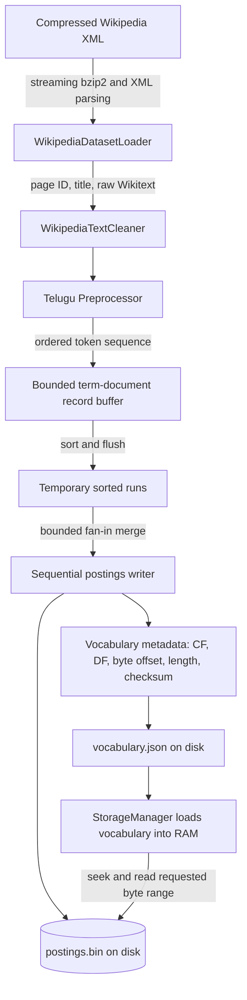

# Telugu Wikipedia Positional Inverted Index

An Information Retrieval assignment project that streams Telugu Wikipedia
articles, cleans their Wikitext, tokenizes Telugu Unicode text, and builds a
positional inverted index with collection frequency (CF) and document frequency
(DF). Vocabulary metadata is held in memory when the index is opened; complete
positional postings are stored on disk and fetched by byte offset.

The repository also retains a separate, legacy in-memory Reuters search
demonstration. It is not part of the Telugu Wikipedia indexing pipeline.

## Dataset and indexed subset

The Telugu pipeline uses the compressed pages-articles dump:

```text
tewiki-latest-pages-articles.xml.bz2
```

The loader streams the bzip2-compressed MediaWiki XML directly. It yields
non-empty, non-redirect pages in the main namespace, retaining the Wikipedia
page ID as the document ID. It does not extract a second uncompressed copy of
the dump. The dump and generated index files are excluded from Git by
`.gitignore`.

The verified local index contains the first **10,000 valid articles** from the
dump. This is a subset, not the complete Telugu Wikipedia corpus. The actual
build encountered 12,911 XML pages while finding those 10,000 valid articles:
2,218 non-main-namespace pages and 693 redirects were skipped; no empty
articles were encountered before the limit was reached.

## Technologies

- Python 3.10 or later
- `mwparserfromhell` for structured MediaWiki markup parsing
- Python standard library: `bz2`, `xml.etree.ElementTree`, SQLite, JSON,
  temporary files, heap-based merging, Unicode normalization, and hashing
- `pytest` for automated tests
- `nltk` for the retained Reuters demo only

Install dependencies from the repository root in PowerShell:

```powershell
py -m venv .venv
.\.venv\Scripts\Activate.ps1
python -m pip install -r requirements.txt
```

`requirements.txt` pins the supported major-version ranges for NLTK, pytest,
and mwparserfromhell. Building or opening the Wikipedia index does not require
downloading the Reuters corpus. The Reuters demo requires its NLTK Reuters
corpus to be available.

## Project structure

```text
.
├── main.py
├── requirements.txt
├── scripts/
│   └── download_dataset.py       # Legacy Reuters corpus helper
├── src/
│   ├── dataset_loader.py         # Legacy Reuters loader
│   ├── disk_index_builder.py     # External-sort disk index builder
│   ├── evaluation.py             # Legacy in-memory evaluation helpers
│   ├── index_builder.py          # In-memory positional-index helper
│   ├── inverted_index.py         # Legacy in-memory term-to-document index
│   ├── positional_index.py       # In-memory positional reference index
│   ├── preprocessor.py           # Unicode NFC normalization and tokenization
│   ├── search_engine.py          # Legacy in-memory Reuters query engine
│   ├── storage_manager.py        # Disk postings access and index validation
│   ├── wikipedia_dataset_loader.py
│   └── wikitext_cleaner.py
└── tests/
    ├── test_disk_index.py
    ├── test_main.py
    ├── test_positional_index.py
    ├── test_preprocessor.py
    ├── test_wikipedia_dataset_loader.py
    ├── test_wikitext_cleaner.py
    └── ...                       # Remaining Reuters and shared tests
```

The generated `storage/` directory is local, ignored output. Its current
generation is selected by `storage/current.json`; each generation contains
`vocabulary.json` and `postings.bin`.

## Processing and storage architecture



### Loading and cleaning

`WikipediaDatasetLoader` uses incremental XML parsing over the bzip2 stream.
It filters non-main-namespace pages, redirects, and empty text and yields each
eligible page with its stable Wikipedia page ID, title, and raw Wikitext.

`WikipediaTextCleaner` parses Wikitext and handles common markup, including
internal and external links, references, headings, formatting, categories,
file/image markup, tables, HTML entities, and tags. It retains readable text
where appropriate and normalizes whitespace and Unicode to NFC.

`Preprocessor` applies NFC normalization and lowercasing, then emits tokens in
source order. Unicode letters and numbers are retained; combining marks remain
attached to a preceding token. Punctuation, underscores, and whitespace are
separators. Telugu stop words are not removed by default, and no English
stemming is applied.

### Positional postings, CF, and DF

For each token in the processed sequence, its zero-based list index is the
token position. Repeated terms receive all of their positions in that
document.

- **CF (collection frequency):** total occurrences of a term across the
  indexed documents.
- **DF (document frequency):** number of distinct indexed documents containing
  that term.
- **Document ID:** the original Wikipedia page ID provided by the loader.
- **Position:** zero-based index in the preprocessor's ordered token sequence.

For example, the processed tokens `["తెలుగు", "భాష", "తెలుగు"]` produce
`తెలుగు → document:[0, 2]` and `భాష → document:[1]`. The first 10,000-article
index reports `తెలుగు` with CF 6,806 and DF 3,251.

### External sorting and disk lookup

The disk builder groups each article's token positions by term, then appends
term/document/positions records to a buffer capped by a configurable record
count (50,000 by default). Full buffers are sorted by term and document ID and
written as temporary runs. Runs are merged externally with a fan-in of at most
32 files per merge operation, using multiple merge levels as needed. Duplicate
document IDs are checked in a temporary SQLite database rather than a
corpus-sized Python set.

During the final merge, postings are written sequentially to `postings.bin`.
Each term's vocabulary entry stores CF, DF, byte offset, byte length, and a
SHA-256 checksum for that serialized record. The vocabulary and postings are
written to a new generation and validated before the single
`current.json` manifest is atomically updated. Previous generations are not
deleted by the builder.

When `StorageManager` opens an index, it loads the vocabulary metadata into
memory and validates the generation ID, record ranges, and file bounds. It
does not load the complete postings file. A term lookup uses the in-memory
metadata to seek to the record's byte offset and read only its byte length;
the record is decoded as UTF-8 and checked against its checksum and CF/DF.
An individual lookup returns all postings for that term, so a very frequent
term can itself have a large result.

The record-count buffer bounds the number of buffered records, not their total
byte size. One large article and the in-memory vocabulary therefore still
affect peak memory. Vocabulary memory is intentionally proportional to the
number of unique terms, as required by the assignment.

## Build, reopen, and search

Place the compressed dump in the repository root, then build the verified
10,000-valid-article subset:

```powershell
python -X utf8 main.py `
  --dump .\tewiki-latest-pages-articles.xml.bz2 `
  --limit 10000 `
  --storage .\storage `
  --verify
```

`--limit` counts valid yielded articles, not all XML pages scanned. The
application reports indexing progress every 500 articles, prints statistics,
and enters an interactive Telugu term prompt when indexing completes.
`--verify` checks every postings record after building. Verification reads the
records one at a time; it does not load the complete postings file.

Open the currently published index later, without reading the XML dump:

```powershell
python -X utf8 main.py --load-existing --storage .\storage
```

To re-run full record verification when opening:

```powershell
python -X utf8 main.py --load-existing --storage .\storage --verify
```

At the prompt, enter one term, for example `తెలుగు`, to display its CF, DF,
and postings; enter `q` to exit. The CLI prints all postings for a found term,
which can produce extensive output for common terms.

The index can also be inspected from Python while limiting displayed examples:

```powershell
@'
import sys
sys.stdout.reconfigure(encoding="utf-8")
from src.storage_manager import StorageManager

index = StorageManager("storage")
term = "\u0c24\u0c46\u0c32\u0c41\u0c17\u0c41"
statistics = index.get_term_statistics(term)
print("Statistics:", statistics)
if statistics is not None:
    postings = index.get_postings(term)
    print("Sample postings:", dict(list(postings.items())[:5]))
'@ | python -X utf8 -
```

The main CLI's `--limit` defaults to 5,000 when omitted. Set it explicitly to
10,000 to reproduce the documented subset size.

## Verified 10,000-article results

The following values are from the actual completed local build and full
postings verification; they are measurements, not estimates.

| Metric | Verified result |
|---|---:|
| Valid documents indexed | 10,000 |
| XML pages encountered to reach the limit | 12,911 |
| Non-main-namespace pages skipped | 2,218 |
| Redirects skipped | 693 |
| Empty articles encountered | 0 |
| Token occurrences | 4,916,974 |
| Total CF summed over vocabulary | 4,916,974 |
| Unique vocabulary terms | 303,366 |
| `postings.bin` | 127,229,948 bytes |
| `vocabulary.json` | 45,875,367 bytes |
| Combined index files | 173,105,315 bytes |
| Build time | 367.4 seconds |
| Full verification time | 106.48 seconds |
| Total elapsed build and verification | 473.88 seconds |
| Estimated retained vocabulary object memory | 127,273,556 bytes |
| Peak process RSS during build/verification | 539,963,392 bytes |
| Peak temporary build data | 312,597,685 bytes |

Memory and timing depend on machine load and environment. The vocabulary
memory value is an estimate of retained Python vocabulary objects; RSS is the
measured process working-set peak. The indexed data is the first 10,000 valid
articles, not the full corpus.

### Actual sample term searches

These are sample excerpts from the actual postings. Positions are zero-based;
posting lists shown here are abbreviated, while the CLI prints the full list.

| Term | Exists | CF | DF | Sample document IDs and positions |
|---|---:|---:|---:|---|
| తెలుగు | Yes | 6,806 | 3,251 | `1:[7]`, `10050:[68]`, `10085:[189,207,215,279]` |
| భారతదేశం | Yes | 447 | 222 | `10267:[281]`, `10277:[34]`, `10278:[17,351]` |
| ఆంధ్రప్రదేశ్ | Yes | 1,714 | 1,008 | `10028:[135]`, `10039:[219]`, `10046:[39]` |
| కంప్యూటర్ | Yes | 131 | 64 | `10306:[71]`, `1150:[291,339]`, `1212:[68,127,151,169,197,246,304,367]` |

## Tests

Run the complete test suite from the repository root:

```powershell
python -m pytest -q
```

The verified result for this project state is **95 passed**. Tests cover
preprocessing, Wikitext cleaning, XML loading, in-memory indexing, disk
serialization and retrieval, checksums, generation publication, and CLI
behavior.

## Limitations

- The delivered disk index covers 10,000 valid articles only; it is not an
  index of the entire Telugu Wikipedia corpus.
- The interactive index CLI supports single-term CF/DF and postings
  inspection. The legacy Reuters CLI's Boolean and phrase-search capabilities
  use separate in-memory Reuters indexes; they do not operate on the Telugu
  disk index.
- The configured sort-buffer limit is in records rather than bytes, and
  vocabulary metadata is held in memory by design.
  - Generated index files and the compressed dataset are local artifacts and
    are not committed to Git.
